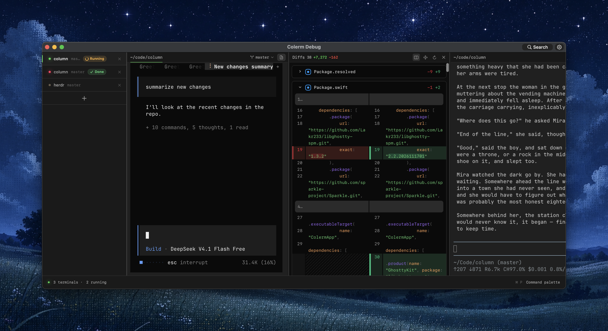

# Colerm

Colerm is a native macOS terminal workspace powered by Ghostty. Run shells
side by side in resizable columns and switch between them with tabs or the
command palette.



[Browser demo](https://colerm.com/#demo) · [Releases](https://github.com/Envl/colerm/releases) · [X](https://x.com/sesampicr) · [Buy me a coffee](https://buymeacoffee.com/envl)

[Download the latest release for macOS](https://github.com/Envl/colerm/releases/latest/download/Colerm.dmg) · macOS 14 or later

## Workspace

- **Columns and tabs** — Resize terminal columns, drag tabs to reorder them, or enable **Vertical Tabs** in Settings for a resizable sidebar.
- **Terminal navigation** — Press `⌘P` to find an open terminal, `⌘1` through `⌘9` to select by position, or `⌃Tab` and `⌃⇧Tab` to cycle. Change the palette and cycling shortcuts in Settings (`⌘,`).
- **Running commands** — See which terminals are busy and jump to a running command from the workspace footer.
- **Git context** — See the current directory, branch, and change counts in each terminal header.
- **Session layout** — Colerm remembers terminal order, widths, and working directories. Relaunching starts fresh shells in those directories.
- **Appearance** — The workspace and terminal palettes follow the system’s light or dark appearance.

- **Git branches and diffs** — Click the branch in a terminal header to switch branches. Click the change count to review uncommitted changes in a resizable pane beside the shell. Choose unified or split view and use `⌘F` to find text in the open diff.
- **Coding agent status** — Tabs show when a detected agent is running, needs input or approval, or has finished. Colerm detects Claude Code, Codex, Pi, OpenCode, Grok, Factory Droid, and Antigravity.
- **File and image paste** — Paste or drop Finder files to insert shell-escaped paths. Paste an image to save a temporary PNG and insert its path.
- **Settings** — Open Settings from the gear next to Search in the window title bar.

## Repository layout

```text
Sources/ColermApp/       Native macOS app
Tests/ColermAppTests/    Swift tests
Resources/               App resources and Ghostty shell integration
Design/AppIcon/          Source artwork for the app icon
website/                 Svelte website and Workers deployment
Vendor/ghostty/          Pinned upstream source submodule
```

The native app keeps terminal surfaces and paging in AppKit. SwiftUI is used
for surrounding controls and settings. Ghostty C types and ABI-sensitive code
are isolated in `Sources/ColermApp/GhosttyBridge`.

## Requirements

- macOS 14 or newer.
- Swift 6.2 or newer and Xcode Command Line Tools.
- Node.js and pnpm for the website.
- Zig only when validating the optional vendored Ghostty source build.

## Native development

```bash
git clone --recurse-submodules https://github.com/Envl/colerm.git
cd colerm

# For an existing clone:
git submodule update --init --recursive

swift build
swift test
./scripts/check.sh
./scripts/run.sh
```

`./scripts/run.sh` builds and launches a relocated debug app bundle. To
regenerate the macOS icon resources:

```bash
./scripts/prepare_app_icon.sh
```

## Releases

Push a protected `v*` tag to build, sign, notarize, and publish the universal
DMG and Sparkle update through GitHub Actions:

```bash
git tag v0.1.0
git push origin v0.1.0
```

The release workflow publishes the stable `Colerm.dmg`, a versioned signed app
archive, and `appcast.xml`. The website can always link to the latest DMG, and
installed release builds use the latest appcast for in-app updates. Configure
the `release` GitHub Environment with these secrets before publishing:

- `MACOS_CERTIFICATE_P12_BASE64`
- `MACOS_CERTIFICATE_PASSWORD`
- `MACOS_KEYCHAIN_PASSWORD`
- `APPLE_ID`
- `APPLE_TEAM_ID`
- `APPLE_APP_SPECIFIC_PASSWORD`
- `SPARKLE_ED_PRIVATE_KEY`

The Sparkle public key is checked into `Resources/SparklePublicKey`; its private
counterpart exists only in the GitHub Actions secret and the release operator's
Keychain. Debug builds embed Sparkle for link compatibility but do not start the
production updater or expose its menu command.

Release builds check the appcast in the background and download signed updates
without opening Sparkle's update window. The titlebar update button appears
after the update is staged and immediately installs it before relaunching Colerm.

Updater archives and the appcast are published when the repository Actions
variable `SPARKLE_UPDATES_ENABLED` is `true`. Leave it disabled for the initial
release, then enable it before publishing the first newer version.

## Website development

```bash
cd website
pnpm install
pnpm dev
```

The [local browser demo](http://127.0.0.1:3990/#demo) uses `@wterm/dom` and
`@wterm/just-bash`. Run commands against sample files in a virtual shell.

Validate the website before opening a pull request:

```bash
pnpm check
pnpm build
```

## Deploying the website

The website is deployed as a Cloudflare Worker serving Vite's static assets.
The production custom domain is [colerm.com](https://colerm.com), configured
in `website/wrangler.jsonc`.

```bash
cd website
pnpm run deploy:dry-run
pnpm run deploy
```

Deployment requires an authenticated Wrangler session with access to the
Cloudflare zone for `colerm.com`.

## Contributing

1. Create a focused branch.
2. Keep native terminal work AppKit-first and preserve the Ghostty bridge
   boundary.
3. Run `./scripts/check.sh` and the website checks relevant to your change.
4. Open a pull request with a short description and verification notes.

Please do not commit credentials, local `.dev.vars` files, build output, or
machine-specific app state.

## License

Colerm source code is available under the MIT License; see [LICENSE](LICENSE).
The vendored Ghostty source and the `GhosttyTerminal` dependency retain their
own upstream license terms; see `Vendor/ghostty/LICENSE`.
